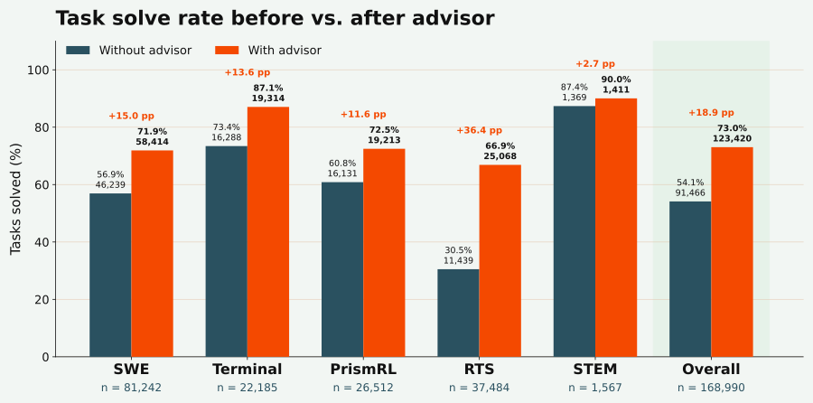

<p align="center"><picture><source media="(prefers-color-scheme: dark)" srcset="assets/ifm-advisor-dark.svg"><source media="(prefers-color-scheme: light)" srcset="assets/ifm-advisor-light.svg"></picture></p>

<p align="center"><a href="https://ifm-ai.github.io/advisor/"></a> <a href="https://ifm.ai/blog/k2/"></a> <a href="https://github.com/ifm-ai"></a> <a href="https://x.com/IFM_AI"></a> <a href="https://discord.gg/SZzAQ3kFJ"></a></p>

# Advisor

A privileged advisor for agentic coding rollouts.

While a solver model works on a task, the advisor reads the task's reference solution, hidden tests
and private notes, reviews the solver's draft turns at chosen checkpoints, and has the solver revise
a turn when it is about to stop at the wrong point. That material never enters the solver's context
or the trajectory: only the solver's own selected response is recorded, so advised and ordinary
rollouts share one representation.

## Advised rollouts

<p align="center"></p>

The solver drafts every turn. At a proposed finish, or every k turns, the advisor reviews the draft
against the privileged material and either keeps it or has the solver regenerate the turn after a
short, solver-safe cue.

Agentic coding rollouts often fail not because the solver makes no progress, but because it stops
at the wrong point: it repairs the most visible symptom and leaves a secondary requirement
unresolved, submits after narrow validation, or keeps editing after reaching a correct solution
and undoes it. The advisor intervenes at exactly those moments, and it never edits the repository
or acts on the task itself.

## Results

Over 168,990 tasks in five categories, the solver on its own solved 91,466 (54.1%). Advised reruns
of tasks it had not solved added 31,954 more, for 123,420 tasks solved (73.0%):
**+18.9 percentage points**. The gain is largest where the solver alone solves least: on RTS, from
30.5% to 66.9%.

<p align="center"></p>

| Category | Tasks | Solved without advisor | Solved by advisor | Solved with advisor | Lift |
|---|---:|---:|---:|---:|---:|
| SWE | 81,242 | 46,239 (56.9%) | 12,175 | 58,414 (71.9%) | +15.0 pp |
| Terminal | 22,185 | 16,288 (73.4%) | 3,026 | 19,314 (87.1%) | +13.6 pp |
| PrismRL | 26,512 | 16,131 (60.8%) | 3,082 | 19,213 (72.5%) | +11.6 pp |
| RTS | 37,484 | 11,439 (30.5%) | 13,629 | 25,068 (66.9%) | +36.4 pp |
| STEM | 1,567 | 1,369 (87.4%) | 42 | 1,411 (90.0%) | +2.7 pp |
| **Overall** | **168,990** | **91,466 (54.1%)** | **31,954** | **123,420 (73.0%)** | **+18.9 pp** |

*Solved by advisor* counts tasks the solver did not solve on its own and then solved in an advised
rerun. *Solved with advisor* counts each task once: solved on its own, or solved in an advised
rerun. It measures how many tasks yield a successful trajectory, not a per-attempt pass rate under
matched conditions. Lift is in percentage points. The raw counts are in [`results/advisor_rescue.csv`](results/advisor_rescue.csv).

## Repository

| Path | Purpose |
| --- | --- |
| [`src/ifm_advisor/advisor.py`](src/ifm_advisor/advisor.py) | `Advisor`: the review gate, typed decisions, cues and solver revisions |
| [`src/ifm_advisor/litellm_hook.py`](src/ifm_advisor/litellm_hook.py) | Runs an agent's `litellm.acompletion` calls through an advisor without changing the agent |
| [`src/ifm_advisor/material.py`](src/ifm_advisor/material.py) | Loads the public instruction and the privileged material from a task directory |
| [`src/ifm_advisor/cues.py`](src/ifm_advisor/cues.py) | Solver-facing cues: a fixed self-check sentence or a reasoning prefill |
| [`src/ifm_advisor/audit/`](src/ifm_advisor/audit/) | `ifm-advisor audit`: leak checks, coherence and leakage judges, the verifier's verdict |
| [`src/ifm_advisor/summarize.py`](src/ifm_advisor/summarize.py) | `ifm-advisor summarize`: per-arm pass rates and advisor statistics |
| [`src/ifm_advisor/prompts/`](src/ifm_advisor/prompts/) | Versioned advisor and solver prompts |
| [`examples/`](examples/) | An offline walkthrough, a custom agent loop, and Harbor with Mini-SWE-Agent |
| [`docs/`](docs/) | Tutorial, how-to guides, explanations and reference (MkDocs) |
| [`results/`](results/README.md) | Result tables and the script that plots them |
| [`tests/`](tests/) | The test suite |
| [`assets/`](assets/) | Figures and banners |

## How it works

**Review.** The advisor reviews a draft only when the review gate is open: the draft calls the
finish tool, or the turn is a multiple of `k`, and the per-attempt intervention budget `B` is not
spent. Its answer is a strictly validated decision: keep the draft (`CONTINUE`), have the solver
review the requirements, trace state transitions, validate more broadly or reconsider its
submission, or confirm a correct implementation (`CONFIRM_AND_SUBMIT`). On an intervention the
solver regenerates its turn with a cue, and the finish tool is withheld unless the action is
`CONFIRM_AND_SUBMIT`. See [the method](docs/explanation/method.md).

| Cue | Delivered as | Use with |
|---|---|---|
| `SelfCheckCue()` (default) | one fixed, task-agnostic user message chosen by the advisor's action | any model and server |
| `ReasoningPrefillCue.k2_horizon_sglang()` | the advisor's hint, as the opening of the solver's next reasoning block | K2-Horizon served by SGLang |

**Isolation.** Privileged material itself never enters the solver's context, but decisions derived
from it do, by design: whether a turn is blocked, which fixed sentence the solver receives, and above
all `CONFIRM_AND_SUBMIT`, which tells the solver its implementation covers the task's requirements.
With `ReasoningPrefillCue`, the advisor's hint itself reaches the solver, as the opening of its
reasoning, and so the trajectory: it is
[guarded, not guaranteed solver-safe](docs/explanation/isolation.md#the-hint-channel-is-guarded-not-guaranteed), by the
prompt's rules, the optional `screen_hints` check and the audit. See
[privileged-information isolation](docs/explanation/isolation.md).

**Audit.** `ifm-advisor audit` checks each advised trajectory before release: offline leak-term and
verbatim-overlap checks over the whole trajectory, a public-coherence judge, a privileged-leakage
judge, and the verifier's own verdict. Any finding fails the audit. See
[audit trajectories](docs/how-to/audit.md).

## Use the advisor

### 1. Install

```bash
git clone https://github.com/ifm-ai/advisor.git
cd advisor
pip install -e .          # Python 3.12+; depends on pydantic and litellm
```

### 2. Walk through three reviews offline

No endpoint and no network:

```bash
python examples/01_offline_quickstart.py
```

See [getting started](docs/tutorial/getting-started.md).

### 3. Add it to your agent loop

```python
from ifm_advisor import Advisor, AdvisorConfig, EndpointConfig, TaskMaterial

config = AdvisorConfig(
    endpoint=EndpointConfig(model="IFM/K2-Horizon-375B-A23B", api_base="http://localhost:30001/v1"),
    max_interventions=2,          # B: interventions per attempt
    periodic_review_interval=4,   # k: also review every 4 solver turns
)
task = TaskMaterial.from_task_dir("path/to/task")   # instruction.md, README.md, solution/, tests/
advisor = Advisor(config, task, finish_tool="complete", trace_dir="runs/attempt-1/advisor")

draft = await solver(messages, tools)
response = await advisor.review(
    messages, draft, tools=tools,
    regenerate=lambda revision: solver(revision.messages, revision.tools, revision.extra_body),
)
```

The advisor's API key is read from `ADVISOR_API_KEY` when a call is made; set `api_key_env` to use
another variable. The key is never stored. See
[add the advisor to your agent loop](docs/how-to/custom-agent-loop.md).

### 4. Run it with Harbor

An agent that calls `litellm.acompletion` in your own process runs through the advisor unchanged.
For Harbor that is the `mini-swe-agent-external-finish` agent, which runs LiteLLM on the host and
exposes a finish tool:

```python
from ifm_advisor import litellm_hook

litellm_hook.install()
with litellm_hook.advised(advisor):
    await run_agent()
```

Harbor's stock installed `mini-swe-agent` runs inside the task container, where the hook cannot
see its calls, and Terminus-2 has no finish tool, so only periodic reviews could apply to it.
Neither is a supported target. See [LiteLLM and Harbor](docs/how-to/litellm-and-harbor.md).

### 5. Audit and summarize runs

```bash
ifm-advisor audit --attempt-dir runs/attempt-1 --task-dir path/to/task \
  --output runs/attempt-1/advisor/audit.json
ifm-advisor summarize --arm baseline='runs/baseline/*' --arm advised='runs/advised/*'
```

The advisor's private trace (`advisor/private_trace.jsonl`) contains text derived from the
privileged material, so never publish that file, and keep `trace_dir` outside anything mounted into
the solver's sandbox (with Harbor, use `<trial>/advisor`, not `<trial>/agent/advisor`). See
[summarize runs and report results](docs/how-to/summarize-and-report.md) and the
[artifacts reference](docs/reference/artifacts.md).

## Development

```bash
pip install -e ".[dev,docs,results]"
pytest                            # -m "not network" skips the K2-Horizon template download
ruff check . && ruff format --check src tests examples results scripts
mypy                              # strict type check of src/
python3 scripts/check_mermaid.py  # needs Node.js: renders every diagram in the docs
mkdocs serve                      # preview the documentation site locally
```

See [CONTRIBUTING.md](CONTRIBUTING.md).

## Citation

If you use Advisor, please cite it:

```bibtex
@misc{pimpalkhute2026advisor,
  title        = {Advisor: A Privileged Advisor for Agentic Coding Rollouts},
  author       = {Pimpalkhute, Varad and Sun, Yuekai and Yurochkin, Mikhail},
  year         = {2026},
  organization = {Institute of Foundation Models, MBZUAI},
  howpublished = {\url{https://github.com/ifm-ai/advisor}},
  note         = {Software}
}
```

## License

Advisor is distributed under the [Apache License 2.0](LICENSE).

## About IFM

Advisor is developed by researchers and engineers at the [Institute of Foundation Models (IFM)](https://ifm.ai/about/) at [MBZUAI](https://mbzuai.ac.ae/). We work on open foundation models, including [K2 Horizon](https://ifm.ai/blog/k2/), and the training systems behind them.

<p><a href="https://ifm.ai/"></a> <a href="https://huggingface.co/IFM"></a> <a href="https://github.com/ifm-ai"></a> <a href="https://x.com/IFM_AI"></a> <a href="https://discord.gg/SZzAQ3kFJ"></a></p>
