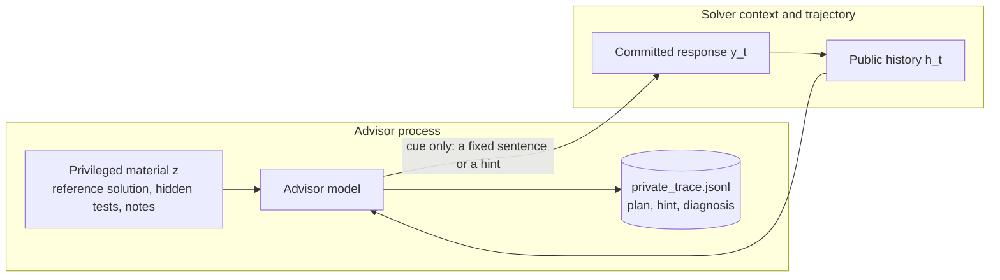

# Privileged-information isolation

The advisor reads the reference solution, the hidden tests and private notes. The point of the
package is that none of that text reaches the solver or its trajectory. There are two channels
through which it could leak, and they are guarded differently. Decisions derived from it, such as
whether to block a finish, do reach the solver by design; see
[below](#decisions-derived-from-the-privileged-material-do-reach-the-solver).

## The structural channel is closed by construction

These guarantees come from the code, and each has a test that pins it.

1. **Only the cue reaches the solver.** On the self-check path the cue comes from a closed set of
   fixed sentences, and an unknown action raises. The advisor's request, decision, plan and
   diagnosis are never added to the solver's context.
   `test_only_the_compiled_sentence_reaches_the_solver`
2. **Only the selected response is returned.** The draft, the advisor's messages and the decision
   never reach the agent, so an advised trajectory has the same shape as an ordinary one.
   `test_real_module_reviews_and_revises_a_finish_call`
3. **The self-check text contains none of the audit's leak markers**, so a solver that echoes the
   cue cannot trip the audit on text this package supplied.
   `test_compiled_instruction_cannot_trip_the_audit`
4. **Privileged material is read only in the advisor's process.** It is never written to a task
   directory or a sandbox, and the manifest records paths, sizes and hashes only.
   `test_manifest_holds_hashes_and_the_task_name_but_no_contents_or_paths`
5. **Credentials are referenced by environment-variable name only** and are never written.
   `test_api_key_value_is_never_serialized`

## The hint channel is guarded, not guaranteed

On the reasoning-prefill path the advisor's `hint` reaches the solver. Its content is not
guaranteed by code. It is guarded by three things:

- the prompt rules, which require the hint to be solver-safe first-person reasoning that cites only
  what is already in the trace, and never quotes or paraphrases privileged material;
- `screen_hints`, which runs the audit's mechanical checks on each hint before delivery and falls
  back to the self-check sentence on a hit;
- the `audit` command, which you run on every advised trajectory before release.

If you cannot accept that residual risk, use `SelfCheckCue`: the solver then sees only fixed
sentences.

## Decisions derived from the privileged material do reach the solver

The privileged material itself never enters the solver's context. Decisions derived from it do, by
design: they are how the advisor helps. Whether a turn is blocked and regenerated, and which fixed
sentence the solver receives, are chosen by an advisor that has read the hidden tests and the
reference solution. The strongest of these signals is `CONFIRM_AND_SUBMIT`, whose sentence opens
"Your current implementation covers the task's requirements": that is a verdict informed by the
hidden tests. A blocked finish says the opposite. These signals carry no privileged text, so the
audit cannot flag them, but they are not free of privileged information. Do not use advised
trajectories where the solver's choices must be independent of the hidden tests.

## Artifacts

Everything the advisor writes goes to its `trace_dir`. All writes are best effort: a failure is
logged and never fails the attempt.

| File | Contents | Publishable |
|---|---|---|
| `private_trace.jsonl` | One record per review: the full decision (`plan`, `hint` and `private_diagnosis` included), the delivered cue, latencies, attempts, errors | No: derived from privileged material |
| `summary.json` | Counters and settings only | Yes |
| `task_material_manifest.json` | Privileged paths, sizes, SHA-256, truncation and omission lists | Only if those paths are already public |
| `audit.json` (written by `audit`) | Verdict, flags, and up to 60 characters of each matched privileged line | No |

Keep `trace_dir` outside any tree you release as training data.

Keep it outside anything mounted into the solver's sandbox, too, or the solver can read
`private_trace.jsonl` while it works. With Harbor, `<trial>/agent` is mounted into the task
container, so a `trace_dir` of `<trial>/agent/advisor` would expose the private trace to the solver
during the run. The documented location, `<trial>/advisor`, is not mounted.

## Where the information flows

## Publishing checklist

- Export `agent/trajectory.json` only, never whole trial directories.
- Put `trace_dir` at `<trial>/advisor`, never under `<trial>/agent`, which the solver's container
  can read.
- Never ship `advisor/private_trace.jsonl` or `advisor/audit.json`.
- `advisor/summary.json` holds counters and labels only and is safe to share.
  `advisor/task_material_manifest.json` holds no file contents, but it lists privileged file paths,
  sizes and hashes: share it only when those paths are already public, such as a public benchmark's
  layout.
- Run `ifm-advisor audit` on every advised trajectory before release.
- With `fail_open=False`, an advisor or revision failure raises into your agent, and the
  exception's traceback frames reference the advisor, its messages and the privileged material.
  Never serialize frame locals for an advised agent, for example with an error reporter that
  captures local variables.
