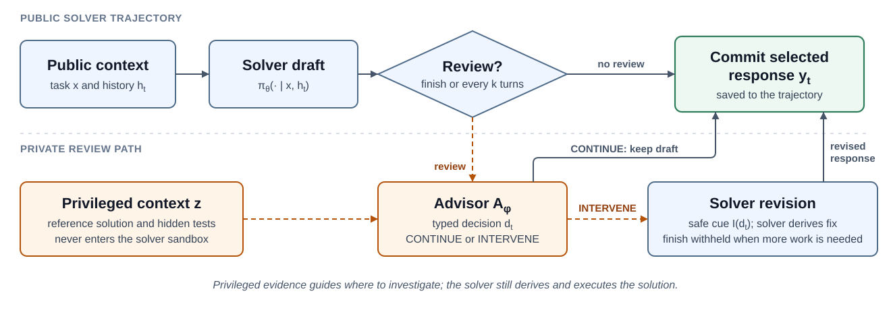
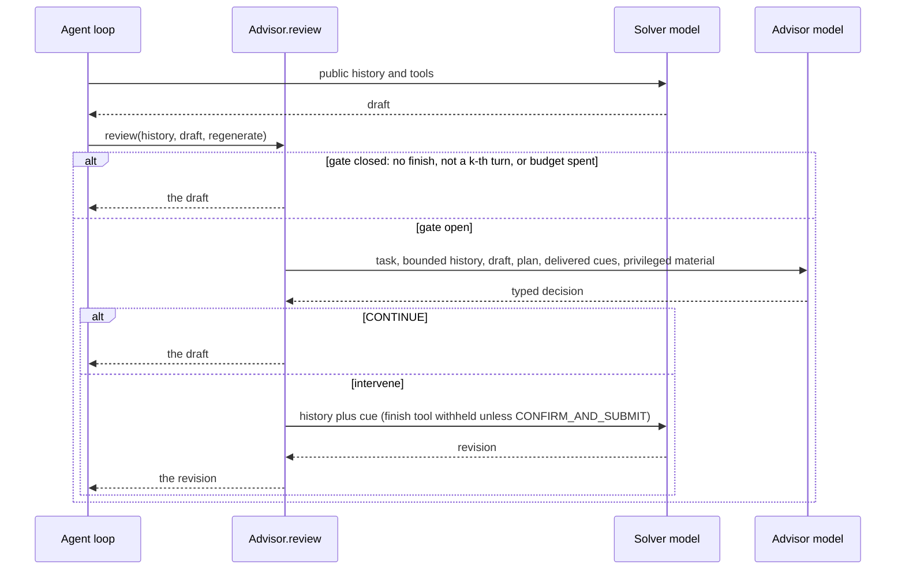

# The method

Agentic coding rollouts often fail not because the solver makes no progress, but because it stops at
the wrong point: it repairs the most visible symptom and leaves a secondary requirement unresolved,
submits after narrow validation, or keeps editing after reaching a correct solution and undoes it.
A privileged advisor intervenes at exactly those moments. It never edits the repository or acts on
the task itself.



## Review gating

The advisor does not review every turn. With $n_t$ interventions used so far, a budget of $B$
interventions and a review interval $k$, the gate at solver turn $t$ is

```math
g_t = \mathbf{1}\left[n_t \lt B\right] \cdot \mathbf{1}\left[\mathrm{Finish}(\tilde{y}_t) \lor (t \bmod k = 0)\right]
```

The advisor reviews the draft $\tilde{y}_t$ when interventions remain and either the draft calls the
finish tool or the turn is a multiple of $k$. When `periodic_review_interval` is `None`, the
periodic term is dropped and only proposed finishes are reviewed.

## Decision

When the gate is open, the advisor produces a decision

```math
d_t = A_\phi\left(x, z, h_t, \tilde{y}_t, p_{t-1}, H_{\lt t}\right)
```

from the public task $x$, the privileged material $z$, the bounded public history $h_t$, the draft,
its own previous plan, and the cues already delivered. The decision is a strictly validated typed
object; see the [decision schema](../reference/decision-schema.md). The advisor judges functional
correctness, not similarity to the reference: a correct implementation that looks nothing like the
reference is correct.

## Selective intervention

The committed response $y_t$ is the draft $\tilde{y}_t$ when the gate is closed or the action is
`CONTINUE`. Otherwise it is a revision

```math
\hat{y}_t \sim \pi_\theta\left(\cdot \mid x, h_t, I(d_t)\right)
```

On an intervention the solver regenerates its turn with the public history plus a solver-safe cue
$I(d_t)$. The finish tool is withheld from the revision unless the action is `CONFIRM_AND_SUBMIT`,
so the solver must take one real action before it can finish.

## Statefulness

The advisor is stateful across reviews of one attempt. It carries its own plan $p_t$, a short to-do
list for the task and where the solver stands against it, so its sense of progress is continuous.
It also sees the cues $H_{\lt t}$ it has already delivered, so a repeat intervention can change the
angle instead of restating an argument the solver has already worked through.

## Notation and code

| Symbol | Meaning | In the code |
|---|---|---|
| $x$ | public task specification | `TaskMaterial.instruction` |
| $z$ | privileged material: reference solution, hidden tests, private notes | `TaskMaterial.files` |
| $h_t$ | public solver history at turn $t$ | the `messages` passed to `Advisor.review` |
| $\tilde{y}_t$ | the solver's draft response | the `draft` passed to `Advisor.review` |
| $t$ | solver turn | `Advisor.solver_calls` |
| $B$ | per-attempt intervention budget | `AdvisorConfig.max_interventions` |
| $n_t$ | interventions used so far | `Advisor.interventions` |
| $k$ | periodic review interval | `AdvisorConfig.periodic_review_interval` |
| $g_t$ | review gate | the first lines of `Advisor.review` |
| $d_t$ | the advisor's decision | `AdvisorDecision` |
| $p_t$ | the advisor's private plan | `AdvisorDecision.plan`, carried as `Advisor.plan` |
| $H_{\lt t}$ | cues already delivered | `Advisor.delivered_cues` |
| $I(d_t)$ | the solver-facing cue | `CompiledCue`, from `SelfCheckCue` or `ReasoningPrefillCue` |
| $\hat{y}_t$ | the solver's revision | what `regenerate(Revision)` returns |
| $y_t$ | the committed response | what `Advisor.review` returns |

## One review


